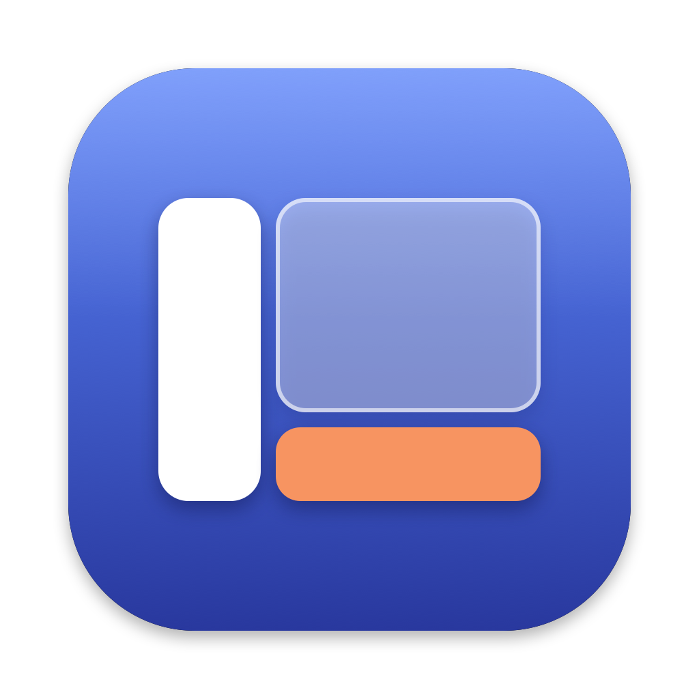

<p align="center"></p>

# Side

Deux panneaux qui apparaissent par-dessus n'importe quelle app du Mac, même en plein écran : un petit Finder, et un tiroir pour la musique, la vidéo et les applications qu'on veut garder sous la main.

On les fait venir d'un geste, on s'en sert, on les referme. Pas besoin de quitter l'app en cours ni de changer de bureau.

## Ce que fait Side

### Le Finder

- **S'ouvre d'un geste** : un coin de l'écran, un geste de souris, quatre doigts sur le trackpad ou un raccourci clavier (⌘@ par défaut).
- **Un vrai navigateur de fichiers** : barre latérale (favoris, récents, tags, disques et serveurs connectés), onglets, présentations en icônes, liste ou colonnes, recherche Spotlight, menu du clic droit, aperçu avec Espace.
- **Une zone de dépôt** : pendant un glisser, une case apparaît à côté de la carte. Ce qu'on y pose reste sous la main, même Side fermé, pour le glisser ailleurs plus tard.
- **Des colonnes épinglées** : glisser un dossier sur le bord droit de la carte le garde affiché en colonne.
- **Un historique du copier-coller**, gardé 7 jours : un volet glisse depuis le bord droit de l'écran, par un coin (en bas à droite par défaut) ou un raccourci clavier (⌃⌥V par défaut). Chaque élément copié y est une carte selon sa nature (image, lien, couleur, fichier…) ; un clic la recopie. En haut, une section « Liens » garde pour toujours, par groupes, les liens qu'on colle souvent.

### Le tiroir

Il arrive du bord opposé au Finder (du bas, en général).

- **Multimédia** : YouTube dans une page intégrée, un lecteur Spotify, ou n'importe quel site ajouté dans les réglages (Deezer, Apple Music, Twitch…). Un seul est affiché, les autres continuent de jouer, même tiroir fermé.
- **Tes applications** : la case « + » range une application dans le tiroir. Sa fenêtre y reste, à côté des autres, dans une bande qu'on fait défiler ; elle ne traîne plus sur le bureau.
- **S'ouvre comme le Finder** : son propre coin actif, son raccourci (⌃⌥Espace par défaut), quatre doigts dans l'autre sens.

### Les réglages

Une fenêtre façon Réglages Système : coins actifs, raccourcis, gestes, puis le Finder et le tiroir, chacun avec ses volets.

## Installation

Il faut un Mac à puce Apple, macOS 14 ou plus récent, et les outils de ligne de commande d'Apple (`xcode-select --install`).

```bash
git clone https://github.com/GauthierAube/Side.git
cd Side
./build.sh
```

Le script compile Side, l'installe dans `~/Applications` et le lance. Une icône apparaît dans la barre des menus, et une courte présentation s'affiche à la première ouverture du Finder, puis du tiroir.

À savoir : sans certificat de développeur Apple dans le trousseau, Side est signé avec une signature jetable. macOS redemande alors les autorisations (accès aux dossiers) après chaque compilation.

## Autorisations et vie privée

- Le Finder de Side ne se connecte à aucun serveur. Le tiroir, lui, affiche les sites que tu y mets (YouTube…) : ils voient ce que voit un navigateur. Side ne récolte rien.
- macOS demande l'accès aux dossiers que Side affiche (Documents, Téléchargements, Bureau).
- macOS demande aussi l'accès au réseau local : Side s'en sert uniquement pour repérer les ordinateurs qui partagent des fichiers (rubrique Réseau). On peut refuser ; la rubrique reste alors vide.
- L'autorisation Accessibilité sert au tiroir : sans elle, Side ne peut pas y ranger la fenêtre d'une autre application. Le Finder et la partie multimédia marchent sans.
- L'autorisation Enregistrement de l'écran est facultative : elle rend plus joli le glissement des applications du tiroir.
- Le lecteur Spotify pilote l'application Spotify du Mac. Son accueil, sa recherche et sa bibliothèque demandent un accès développeur Spotify (gratuit), expliqué dans le lecteur ; le jeton reste dans le trousseau du Mac.
- Couper les publicités de YouTube est un réglage, désactivé au départ : c'est contraire aux conditions d'utilisation de YouTube, à chacun de décider.
- L'historique du copier-coller garde 7 jours de textes et de noms de fichiers copiés, dans un fichier lisible par toi seul (`~/Library/Application Support/Side/presse-papiers.json`), et les 40 dernières images copiées dans le dossier `images` à côté. Les mots de passe copiés depuis un gestionnaire de mots de passe ne sont jamais écrits sur le disque. Un réglage coupe l'historique et efface tout.
- Pour montrer l'aperçu d'un lien copié (image et titre du site), Side contacte ce site, et seulement quand le volet du presse-papiers affiche le lien. Un réglage coupe ces aperçus.

## Limites connues

- Projet personnel, écrit rapidement avec l'aide d'une IA : il reste sûrement des bugs.
- L'interface existe en français et en anglais : elle suit la langue du Mac (anglais si le Mac n'est pas en français), et se choisit dans les réglages.
- Le Finder tient dans un seul fichier, `Sources/Side.swift` ; le tiroir dans les fichiers `Sources/PanneauBas*.swift`.
- Le tiroir déplace les fenêtres d'autres applications : certaines s'y prêtent mal (taille minimale, plusieurs bureaux, plein écran d'Apple).
- YouTube change souvent sa page : les réglages propres à YouTube peuvent demander une mise à jour.
- AirDrop n'est pas pris en charge. La corbeille s'affiche dans la carte, mais demande l'« Accès complet au disque ». Pour le réseau, Side repère les ordinateurs mais la première connexion se fait dans le Finder.

## Les applications compagnes

Side va bien avec deux autres petites applications, signalées dans ses réglages :

- Square (bientôt publié) : les applications en plein écran, en grille, et un Dock.
- [Mulot](https://github.com/GauthierAube/Mulot) : les boutons et les gestes de la souris MX Master, sans le logiciel de Logitech.

## Licence

MIT — voir [LICENSE](LICENSE).

## Historique

Tous les changements sont notés dans [changes-side.md](changes-side.md), du plus récent au plus ancien.
